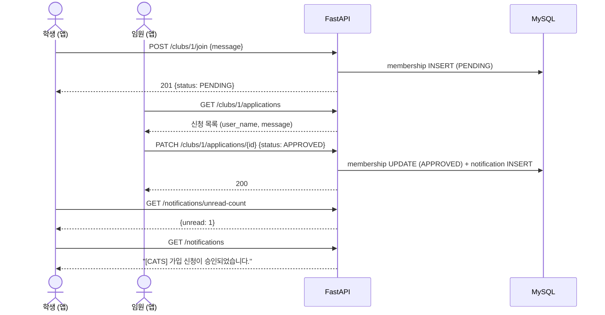

# Club-it 앱-서버 데이터 흐름

Flutter 앱(`mobile/`)의 화면별로 어떤 서버 API를 언제 부르고, 응답의 어떤 값을 화면에 쓰는지 정리한 문서입니다.
API 전체 목록과 서버 실행 방법은 [`backend/README.md`](../backend/README.md), 실제 요청/응답 모양은 서버 실행 후 `http://localhost:8001/docs`에서 확인합니다.

```
[Flutter 앱]                         [FastAPI 서버 :8001]              [MySQL clubit]
 화면 → Provider → Repository ──HTTP(JSON)──▶ routers/*.py ──SQLAlchemy──▶ 7개 테이블
                    (Mock → Api로 교체)       └─▶ LLM API (작성 보조)
```

---

## 1. 공통 규칙

| 항목 | 규칙 |
|---|---|
| 서버 주소 | 안드로이드 에뮬레이터 `http://10.0.2.2:8001` / 웹·윈도우 `http://localhost:8001` / 실제 폰 `http://<PC IP>:8001` (서버를 `--host 0.0.0.0`으로 실행) |
| 데이터 형식 | 요청·응답 모두 JSON, 필드 이름은 **snake_case** (`club_id`, `recruit_status`) |
| 로그인 토큰 | `POST /auth/login` 응답의 `access_token`을 기기에 저장 → 이후 모든 요청 헤더에 `Authorization: Bearer <토큰>` |
| 토큰 유효기간 | 24시간. 만료되면 서버가 **401** → 토큰 삭제 후 로그인 화면으로 |
| 오류 응답 | 대부분 `{"detail": "사용자에게 보여줄 한글 메시지"}` → 그대로 스낵바에 표시. 단 **422**(입력 형식 오류)는 `detail`이 목록이라 "입력값을 확인해주세요" 정도로 처리 |
| 날짜 | `"2026-10-28T17:05:12"` 형식 문자열 → `DateTime.parse()` |
| 상태 코드 | 200 조회·수정 성공 / 201 생성 성공 / 204 삭제 성공(본문 없음) / 400 잘못된 요청 / 401 로그인 필요 / 403 권한 없음 / 404 없음 / 409 중복 |

추천 패키지: `http`(또는 `dio`) — API 호출, `shared_preferences`(또는 `flutter_secure_storage`) — 토큰 저장

---

## 2. 화면별 흐름

### 로그인 `/login`
| 동작 | API | 처리 |
|---|---|---|
| 로그인 버튼 | `POST /auth/login` `{email, password}` | 200 → `access_token` 저장 → `AuthProvider.isLoggedIn = true` → 홈 이동 / 401 → "이메일 또는 비밀번호가 올바르지 않습니다." |
| 앱 시작 시 | `GET /auth/me` (저장된 토큰이 있을 때) | 200 → 자동 로그인 / 401 → 토큰 삭제, 로그인 화면 |

### 회원가입 `/signup`
| 동작 | API | 처리 |
|---|---|---|
| 가입 버튼 | `POST /auth/signup` `{email, password, name}` | 201 → 로그인 화면으로(또는 바로 로그인 API 호출) / 409 → "이미 가입된 이메일입니다." / 422 → 이메일 형식·비밀번호 8자 이상 확인 |

> ⚠️ 현재 `signup_screen.dart` TODO에 **학번·학과**가 있지만 DB에 없습니다 (요구사항: 재학생 인증 범위 밖, 이메일·비밀번호·이름만). 입력란에서 빼주세요.

### 홈 (동아리 목록) `/`
| 동작 | API | 처리 |
|---|---|---|
| 화면 진입 | `GET /clubs` (토큰 함께) | 카드 목록. 토큰을 보내면 `is_favorite`, `my_status`가 채워짐 |
| 검색 | `GET /clubs?q=검색어` 또는 받아둔 목록에서 앱이 직접 필터 (지금 방식 유지 가능) | |
| 분야·모집중 필터 | `GET /clubs?category=학술&recruiting=true` | |
| 별(즐겨찾기) 누름 | 켜기 `POST /clubs/{club_id}/favorite` / 끄기 `DELETE /clubs/{club_id}/favorite` | 성공하면 `ClubProvider`의 즐겨찾기 상태 갱신 |

카드에 쓰는 값: `club_name`, `category`, `description`(첫 줄을 한 줄 소개로), `recruit_status`, `member_count`, `is_favorite`

### 동아리 상세 `/clubs/:clubId`
| 동작 | API | 처리 |
|---|---|---|
| 화면 진입 | `GET /clubs/{club_id}` (토큰 함께) | 헤더·[소개] 탭 + 하단 버튼 결정 |
| [게시판] 탭 | `GET /clubs/{club_id}/posts?post_type=` | 최신순 목록. `post_type`으로 모집글/공지/홍보 탭 나누기 가능 |
| 게시물 누름 | → `/posts/:postId` 이동 | |

**하단 버튼은 `recruit_status` + `my_status`로 결정**

| `my_status` | 버튼 | 누르면 |
|---|---|---|
| `null` / `REJECTED` / `CANCELED` + 모집 중 | 가입 신청 | `/clubs/:id/apply` 이동 |
| `null` / `REJECTED` / `CANCELED` + 모집 아님 | 모집 기간이 아닙니다 (비활성) | — |
| `PENDING` | 신청 취소 | `POST /clubs/{club_id}/join/cancel` |
| `APPROVED` | 가입 완료 (비활성) | — |

`my_role == "OFFICER"`이면 임원 메뉴(신청 관리, 글쓰기, 멤버 목록) 표시 → 아래 4번 참고

### 가입 신청 `/clubs/:clubId/apply`
| 동작 | API | 처리 |
|---|---|---|
| 신청하기 | `POST /clubs/{club_id}/join` `{message: "가입 사유"}` | 201 → "신청이 완료되었습니다" 후 상세로 돌아가서 다시 조회 / 400 모집 아님 / 409 이미 신청·가입 |

### 게시물 상세 `/posts/:postId`
| 동작 | API | 처리 |
|---|---|---|
| 화면 진입 | `GET /posts/{post_id}` + `GET /posts/{post_id}/comments` | 제목·작성자(`author_name`)·본문·작성일, 댓글 목록 |
| 댓글 등록 | `POST /posts/{post_id}/comments` `{content}` | 201 → 목록 맨 아래에 추가 |
| 내 댓글 수정·삭제 | `PATCH /comments/{comment_id}` / `DELETE /comments/{comment_id}` | 댓글의 `user_id`가 내 `user_id`(`/auth/me`)일 때만 메뉴 표시 |

### 즐겨찾기 탭 `/favorites`
| 동작 | API | 처리 |
|---|---|---|
| 화면 진입 | `GET /me/favorites` | `club_name`, `notify_enabled` |
| 알림 스위치 | `PATCH /clubs/{club_id}/favorite` `{notify_enabled: false}` | 끄면 그 동아리 새 글 알림이 안 옴 |

### 알림 탭 `/notifications`
| 동작 | API | 처리 |
|---|---|---|
| 하단 탭 배지 | `GET /notifications/unread-count` → `{unread: 3}` | 앱 시작·탭 이동 시 갱신 |
| 화면 진입 | `GET /notifications` | `message`, `is_read`(안 읽은 건 굵게), `created_at` |
| 알림 누름 | `PATCH /notifications/{notification_id}/read` → `post_id`가 있으면 `/posts/:postId` 이동 | 가입 승인·거절 알림은 `post_id`가 `null` → 마이페이지로 |
| 모두 읽음 | `POST /notifications/read-all` | |

### 마이 `/my`
| 동작 | API | 처리 |
|---|---|---|
| 화면 진입 | `GET /auth/me` + `GET /me/memberships` | 내 정보 + 신청 현황(`club_name`, `status`, 거절 시 `reject_reason`) |
| 로그아웃 | (서버 호출 없음) | 저장한 토큰 삭제 → `AuthProvider.logout()` |

---

## 3. 대표 시나리오: 가입 신청 → 승인 → 알림



새 게시물 알림도 같은 방식: 임원이 `POST /clubs/{id}/posts` → 그 동아리를 즐겨찾기하고 `notify_enabled=true`인 사용자에게 `notification`(post_id 포함)이 자동 생성됩니다.

---

## 4. 임원·관리자 기능 (화면 아직 없음 — 필요 시 추가)

| 기능 | API | 누가 |
|---|---|---|
| 신청 관리 | `GET /clubs/{club_id}/applications` → `PATCH .../applications/{membership_id}` `{status, reject_reason}` | 동아리 임원 |
| 멤버 목록 | `GET /clubs/{club_id}/members` | 동아리 임원 |
| 글쓰기 | `POST /clubs/{club_id}/posts` `{post_type, title, content}` | 동아리 임원 |
| 글쓰기 AI 보조 | `POST /ai/assist` `{task, post_type, club_id, text}` → 제목 추천은 `suggestions`(5개), 나머지는 `result` | 로그인 사용자 |
| 동아리 등록 | `POST /clubs` | `role`이 OFFICER·ADMIN |
| 동아리 정보·모집 여부 수정 / 삭제 | `PATCH /clubs/{club_id}` / `DELETE /clubs/{club_id}` | 동아리 임원 |
| OFFICER 지정·회수, 임원 목록 | `/admin/users`, `/admin/users/{id}/role`, `/admin/officers` | 관리자 |

---

## 5. Flutter 모델 ↔ 서버 응답 매핑

### Club (`mobile/lib/data/models/club.dart`)

| Flutter 필드 | 서버 응답 | 비고 |
|---|---|---|
| `id` | `club_id` | |
| `name` | `club_name` | |
| `category` | `category` | null일 수 있음 → `'기타'` |
| `summary` | (없음) | `description`의 첫 줄 사용 |
| `description` | `description` | null 가능 |
| `isRecruiting` | `recruit_status` | |
| `memberCount` | `member_count` | 승인된 멤버 수 |
| (추가 권장) `isFavorite` | `is_favorite` | 토큰 보낼 때만 의미 있음 |
| (추가 권장) `myStatus` | `my_status` | `PENDING/APPROVED/REJECTED/CANCELED/null` |
| (추가 권장) `myRole` | `my_role` | `OFFICER/MEMBER/null` |

`fromJson`을 서버 응답에 맞게 바꾼 예:

```dart
factory Club.fromJson(Map<String, dynamic> json) {
  final description = json['description'] as String? ?? '';
  return Club(
    id: json['club_id'] as int,
    name: json['club_name'] as String,
    category: json['category'] as String? ?? '기타',
    summary: description.split('\n').first,
    description: description,
    isRecruiting: json['recruit_status'] as bool? ?? false,
    memberCount: json['member_count'] as int? ?? 0,
  );
}
```

### 다른 응답 모델 (새로 만들 때 참고)

| 모델 | 서버 필드 |
|---|---|
| User | `user_id, email, name, role, created_at` |
| Post | `post_id, club_id, user_id, author_name, post_type, title, content, created_at, comment_count` |
| Comment | `comment_id, post_id, user_id, author_name, content, created_at` |
| Membership(내 신청) | `membership_id, club_id, club_name, member_role, status, join_date, message, reject_reason` |
| Favorite | `favorite_id, club_id, club_name, notify_enabled, created_at` |
| Notification | `notification_id, message, post_id, is_read, created_at` |

---

## 6. 연결 순서 제안

1. `ApiClient` (서버 주소 + 토큰 헤더 + 401 처리) 만들기
2. 로그인·회원가입 → `AuthProvider`에 토큰 저장 연결
3. `ApiClubRepository implements ClubRepository` → `main.dart`에서 Mock 대신 사용 (홈·상세)
4. 즐겨찾기 → 가입 신청 → 마이페이지
5. 게시물·댓글 → 알림
6. 임원 화면 + AI 글쓰기 보조

테스트 계정 (서버에서 `python -m app.init_db` → `python -m app.seed` 후, 비밀번호 모두 `test1234`)
- 학생 `student1@cbnu.ac.kr` (CATS 가입 대기, IPSE 대기·즐겨찾기 알림 꺼짐)
- 임원 `officer1@cbnu.ac.kr` (CATS·COSMIC), `officer2@cbnu.ac.kr` (IPSE·CERT)
- 관리자 `admin@cbnu.ac.kr`
